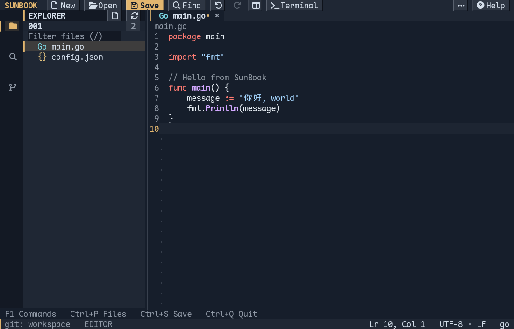
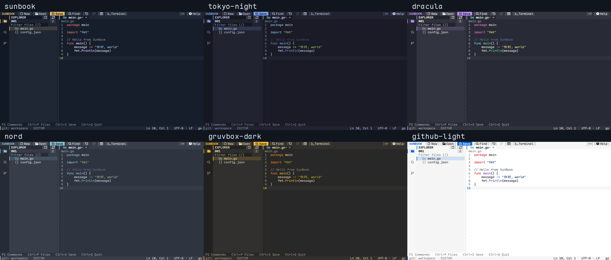
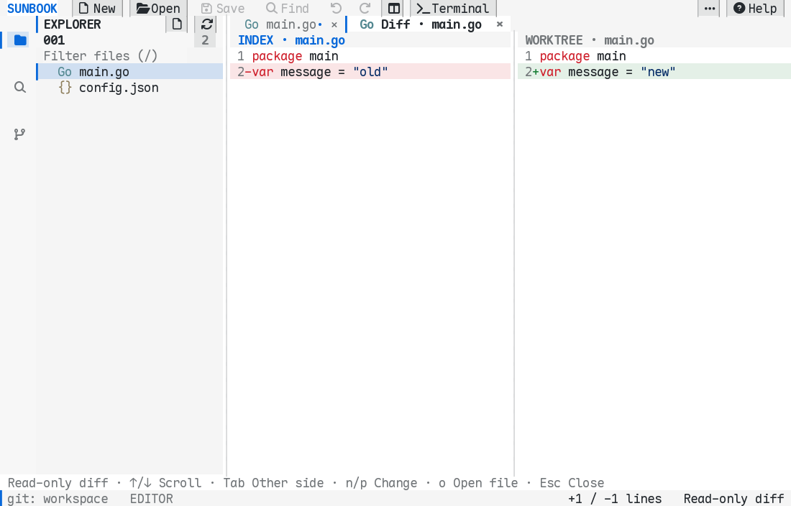

# SunBook

[](https://github.com/Sunmedalia/SunBook/actions/workflows/ci.yml)
[](https://github.com/Sunmedalia/SunBook/releases/latest)


用 Go 编写的终端文本编辑器。在终端里使用熟悉的活动栏、文件标签、分屏、Git 对比和内置终端，同时支持鼠标与键盘操作。

界面使用英文，支持中文、Emoji 和组合字符编辑。基础编辑无需安装语言服务器。



[下载安装](#安装) · [快速上手](#快速上手) · [快捷键](#常用快捷键) · [主题](#主题) · [详细操作手册（English）](docs/usage.md)

## 功能

| 功能 | 使用方式 |
| --- | --- |
| 文件浏览 | Explorer 支持目录展开、文件名/路径过滤和语言图标；单击预览，双击固定标签 |
| 编辑与分屏 | 多标签、标签拖动排序、拖到编辑区边缘分屏；支持多光标、撤销/重做和鼠标选区；内容区提供可点击、拖动的窄滚动条 |
| 搜索与打开 | `Ctrl+P` 模糊查找文件，支持 `file:line:column`；`Ctrl+O` 浏览目录并编辑路径 |
| 工作区搜索 | ripgrep 搜索、匹配高亮、文件分组，以及大小写、整词、正则和路径过滤 |
| Git | 暂存/取消暂存、提交、静默刷新；Git Log 显示文件数和可展开目录树，点击历史文件可查看对应版本对比 |
| 内置终端 | 真实 PTY、滚动历史；可在底部和右侧之间切换，隐藏后保留 Shell 会话 |
| 语言服务 | Go、Python、JS/TS 的补全、定义、引用、悬浮信息、重命名、格式化和诊断 |
| 主题 | 6 套深浅主题，可在界面中切换并自动记住选择 |
| 文件保存 | 保留 UTF-8 BOM、LF/CRLF 和文件权限；原子保存、未保存提醒与磁盘冲突检测 |

## 安装

### 下载 Release

在 [Releases](https://github.com/Sunmedalia/SunBook/releases/latest) 下载对应平台的压缩包，**无需安装 Go**。

| 平台 | v0.1.0 安装包 |
| --- | --- |
| macOS · Apple Silicon | `sunbook_0.1.0_darwin_arm64.tar.gz` |
| macOS · Intel | `sunbook_0.1.0_darwin_amd64.tar.gz` |
| Linux · x86-64 | `sunbook_0.1.0_linux_amd64.tar.gz` |
| Linux · ARM64 | `sunbook_0.1.0_linux_arm64.tar.gz` |

例如在 Apple Silicon Mac 上安装：

```sh
curl -fLO https://github.com/Sunmedalia/SunBook/releases/download/v0.1.0/sunbook_0.1.0_darwin_arm64.tar.gz
curl -fLO https://github.com/Sunmedalia/SunBook/releases/download/v0.1.0/SHA256SUMS
shasum -a 256 --check --ignore-missing SHA256SUMS

tar -xzf sunbook_0.1.0_darwin_arm64.tar.gz
mkdir -p "$HOME/.local/bin"
install -m 755 sunbook_0.1.0_darwin_arm64/sunbook "$HOME/.local/bin/sunbook"
"$HOME/.local/bin/sunbook" --version
```

将 `~/.local/bin` 加入 `PATH` 后即可直接运行 `sunbook`。Linux 校验压缩包可使用 `sha256sum --check --ignore-missing SHA256SUMS`。

### 从源码构建

需要 **Go 1.26.2 或更新版本**：

```sh
git clone https://github.com/Sunmedalia/SunBook.git
cd SunBook
make build
./sunbook .
```

也可以在仓库中执行 `go install ./cmd/sunbook`，安装到 Go bin 目录。

## 快速上手

```sh
sunbook .                    # 打开当前工作区
sunbook path/to/main.go       # 打开文件，以其父目录作为工作区
sunbook --doctor             # 检查可选依赖和配置路径
sunbook --config config.json .
```

使用支持 UTF-8、真彩色和鼠标事件的终端。默认按钮图标使用 Nerd Font，请在终端选择例如 **Maple Mono NF** 的字体；普通字体可在配置中设置 `"activityIcons": "unicode"`。

左下角 **⚙ Settings** 可配置文件图标、按钮/侧栏图标和主题，选择后即时生效并保存。文件图标默认使用 **Expressive**：🐍 Python、🦀 Rust、🐹 Go、☕ Java、💎 Ruby、🐘 PHP、🐳 Docker；文件夹、文档、媒体和锁文件也有对应图标。**Classic** 完整保留原来的 `Py / Rs / Go` 文字图标，随时可切回。文件图标不依赖 Nerd Font，Emoji 的显示样式由宿主终端决定。

- **找文件**：点击 Explorer，或按 `Ctrl+P` 搜索路径。单击文件使用斜体预览标签，双击文件或标签将其固定；编辑、保存、拖动时也会自动固定。
- **新建与保存**：点击 **New** 或按 `Ctrl+N`，直接显示一个文件名输入框：留空按 Enter 创建未命名草稿，输入名称或路径后按 Enter 创建命名文件。新文件使用 Explorer 选中的文件夹，选中文件则使用它的父目录；点击工作区名称可回到根目录。未命名草稿会记住创建目录，保存时只显示一个紧凑的路径输入框，按 Esc 保留草稿；已有文件直接保存。
- **删除文件**：选中文件后点击 Explorer 顶部的垃圾桶，或在 Explorer 聚焦时按 `Delete`；确认后从磁盘删除。已打开的干净标签自动关闭，未保存的修改会保留，按 Save 可以恢复文件。`F1 → File: Delete Current File…` 可删除当前编辑文件。
- **调整布局**：拖动侧边栏和面板边界调整尺寸；拖动标签排序，拖到编辑区左/右边缘分屏。
- **使用终端**：`F4` 打开或切换焦点；`Ctrl+J` 或 X 按钮隐藏并保留会话；`Terminal` 旁的 `+` 创建独立终端，点击会话编号在按钮下方展开列表，鼠标点击或方向键加 Enter 切换，Esc / 点击外部关闭列表。垃圾桶只关闭当前 Shell，有其他会话时自动切换。面板箭头可切换到底部或右侧，快捷键说明集中在右上角 Help。
- **查看帮助**：右上角 **Help** 展示当前快捷键；`F1` 打开包含全部操作的命令面板。

## 常用快捷键

| 快捷键 | 操作 |
| --- | --- |
| `F1` / `Ctrl+Shift+P` | 命令面板 |
| `Ctrl+P` / `Ctrl+O` | 快速打开 / 文件浏览器 |
| `Ctrl+N` / `Ctrl+W` | 新文件 / 关闭标签 |
| `Ctrl+S` / `Ctrl+Shift+S` | 保存 / 另存为 |
| `Ctrl+Z` / `Ctrl+Y` | 撤销 / 重做 |
| `Ctrl+F` / `Ctrl+H` | 文件内查找 / 替换 |
| `Ctrl+Shift+E` / `Ctrl+Shift+F` / `Ctrl+Shift+G` | Explorer / Search / Git |
| `Ctrl+B` / `Ctrl+J` | 显示或隐藏侧边栏 / 面板 |
| `Ctrl+\` | 切换编辑器分屏 |
| `Ctrl+K`，再 `Ctrl+O` | 聚焦另一编辑器 |
| `Ctrl+K`，再 `Ctrl+T` | 选择主题（编辑器内） |
| `Ctrl+D` / `Alt+单击` | 选择下一个匹配 / 添加光标 |
| `F4` / `F6` | 终端焦点 / 循环切换区域焦点 |
| `F12` / `Shift+F12` | 定义 / 引用 |
| `Alt+Shift+F` | 格式化文档 |
| `Ctrl+Q` | 退出，并检查未保存文件 |

终端可能截获部分组合键，可使用 `F1` 查找对应命令。Shell 聚焦时，`Ctrl+C` 等按键发送给子进程；`F1`、`F4`、`F6` 和侧边栏快捷键仍由编辑器处理。

## 主题

提供 **SunBook、Tokyo Night、Dracula、Nord、Gruvbox Dark、GitHub Light**。

另外提供 **Auto** 和 **Terminal Default**：Auto 读取终端的默认前景、背景色，自动匹配深浅色高亮；终端不支持颜色查询时，优先读取 `COLORFGBG`，否则使用终端默认色。Terminal Default 不填充界面背景，保留宿主终端的背景色或透明效果，文字与高亮也使用终端默认色和 ANSI 调色板。选中行通过反色保持可见，子终端程序主动设置的颜色仍会保留。

通过 **F1 → Preferences: Color Theme…** 选择；支持名称过滤和配色预览。界面、代码高亮和 Git 对比同步切换，选择保存到当前配置文件。



## Git 对比

点击 Git 侧边栏中的文件，查看只读双栏对比：暂存修改比较 **HEAD → Index**，未暂存修改比较 **Index → Worktree**。两个版本分别进行语法高亮，并保留红绿增删底色。



在变更列表使用 `s` / `u` 暂存或取消暂存，`c` 输入提交信息。Git Log 每次提交下显示修改文件数；单击或 Enter 展开目录树，左右方向键折叠/展开，点击文件查看该提交与父提交的对比，`d` 查看完整提交补丁。合并提交与第一父提交比较，新增或删除文件也能查看。刷新保留展开状态、选中文件和滚动位置，日志边界可拖动调整高度。

在对比视图按 `o` 打开工作文件，`n` / `p` 跳转变更，`Ctrl+W` 关闭对比。编辑区、双栏对比和文本详情右侧都提供一列宽的滚动条；可点击轨道跳转或拖动滑块滚动。

Git 操作针对磁盘上已保存的文件；应用内暂不提供 push、分支管理或丢弃修改功能。

## 配置与可选依赖

运行 `sunbook --doctor` 查看配置路径：macOS 默认位于 `~/Library/Application Support/SunBook/config.json`；Linux 默认位于 `$XDG_CONFIG_HOME/SunBook/config.json`，未设置时使用 `~/.config/SunBook/config.json`。

配置按字段与默认值合并，可参考 [config.example.json](config.example.json)：

```json
{
  "theme": { "name": "nord" },
  "activityIcons": "nerd",
  "fileIcons": "expressive",
  "tabSize": 4,
  "insertSpaces": true,
  "keybindings": { "f8": "language.format" }
}
```

主题名称为 `sunbook`、`tokyo-night`、`dracula`、`nord`、`gruvbox-dark`、`github-light`；可覆盖 `background`、`foreground`、`accent`、`syntax`。在界面选择主题会替换主题覆盖项，保留其他配置。快捷键设为空字符串可禁用；组合顺序为 `ctrl+alt+shift+key`，多段快捷键用空格分隔。

`fileIcons` 支持 `expressive`（语言/类型图标）和 `classic`（原有文字图标）；`activityIcons` 支持 `nerd` 和 `unicode`，控制按钮及侧栏。这两项可在 Settings 单独切换，保存到当前配置文件，包括自定义 `--config` 路径。窄窗口也可以通过 `F1 → Preferences: Settings…` 进入设置。

| 可选工具 | 用途 |
| --- | --- |
| `git` | Source Control、Git Log 和版本对比 |
| `rg`（ripgrep） | 工作区全文搜索与遵循忽略规则的文件索引 |
| `gopls` | Go 语言服务 |
| `pyright-langserver` | Python 语言服务 |
| `typescript-language-server`、TypeScript | JS/TS 语言服务 |
| `ruff` | Python 格式化 |
| `pbcopy` / `pbpaste`、`wl-copy` / `wl-paste` 或 `xclip` | macOS / Wayland / X11 系统剪贴板 |

安装命令、LSP 设置、完整快捷键与各面板说明见 [详细操作手册](docs/usage.md)。工具缺失时基础编辑仍然可用，内置终端默认使用 `$SHELL` 或 `/bin/sh`。

## 开发、CI 与发布

```sh
make build                  # 构建本机程序
make check                  # 竞态测试和 go vet
make smoke                  # 真实 PTY 冒烟测试，需要 git、ripgrep 和 Python 3
python3 scripts/package_release.py --version 0.1.0 --os darwin --arch arm64
```

[CI](https://github.com/Sunmedalia/SunBook/actions/workflows/ci.yml) 在 macOS 和 Linux 上检查格式、依赖、竞态、vet 与真实终端交互。推送 `vX.Y.Z` 标签会运行同样的检查，再打包四个平台、生成 `SHA256SUMS` 并发布 [Release](https://github.com/Sunmedalia/SunBook/releases)。发布说明放在 `docs/releases/<tag>.md`；没有对应文件时自动生成。

发布记录见 [CHANGELOG.md](CHANGELOG.md)。项目结构与可选集成测试见 [详细操作手册](docs/usage.md#development-and-verification)。

基础编辑支持 macOS/Linux；暂不支持 Windows、DAP 调试、扩展插件、远程开发和 Vim 模式。二进制及非 UTF-8 文件会拒绝打开，超过 2 MiB 的内容关闭语法高亮。
